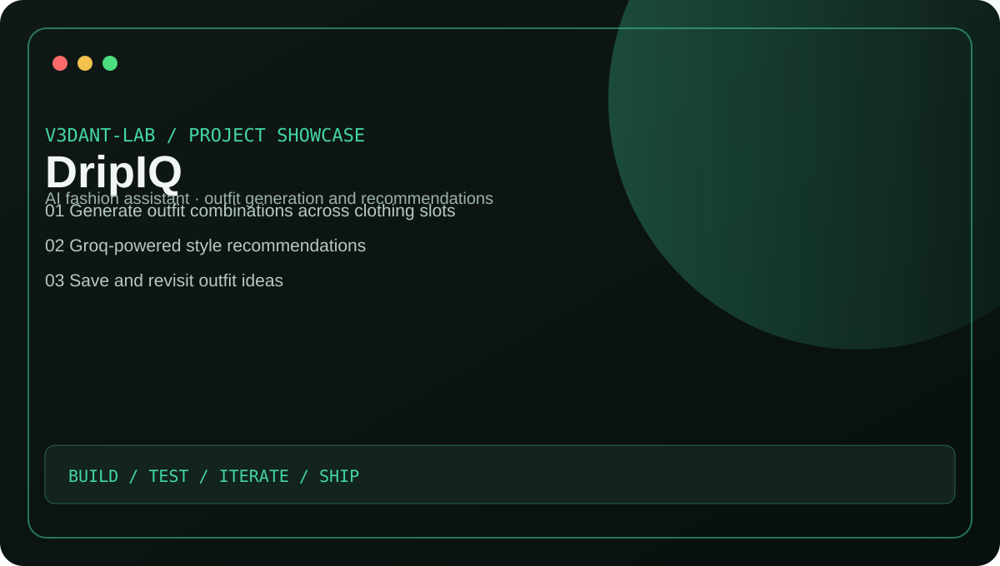
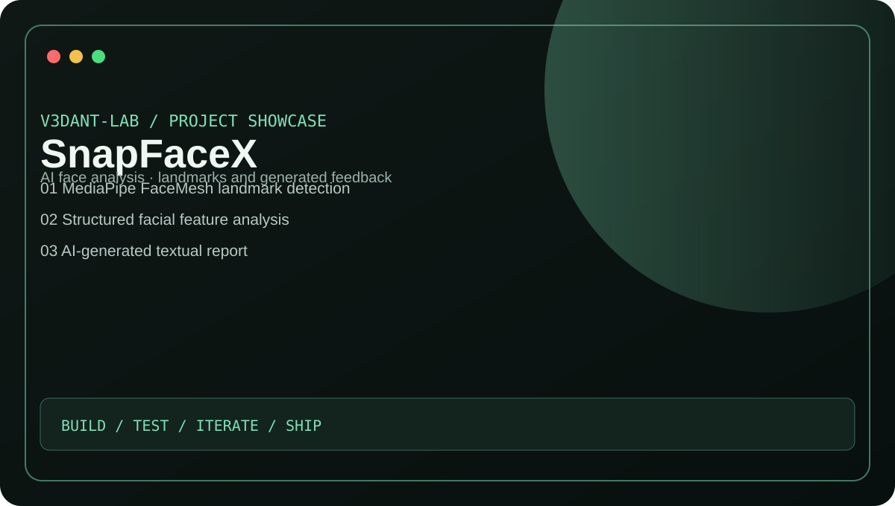
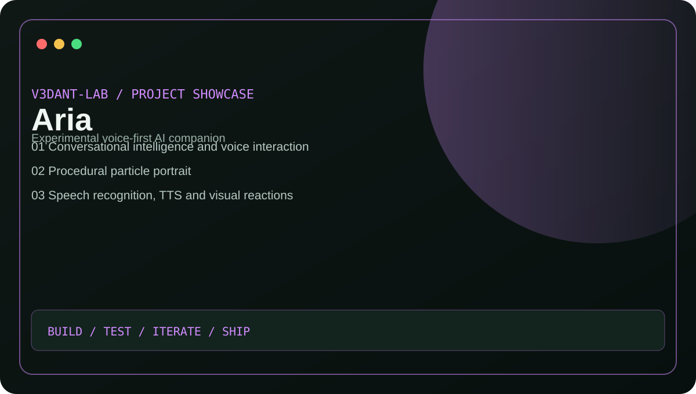
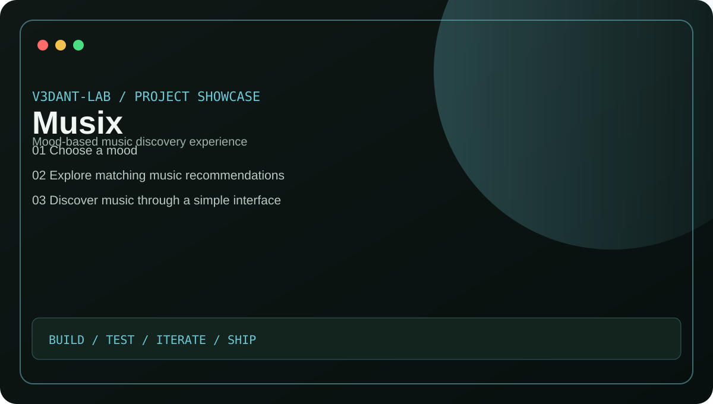
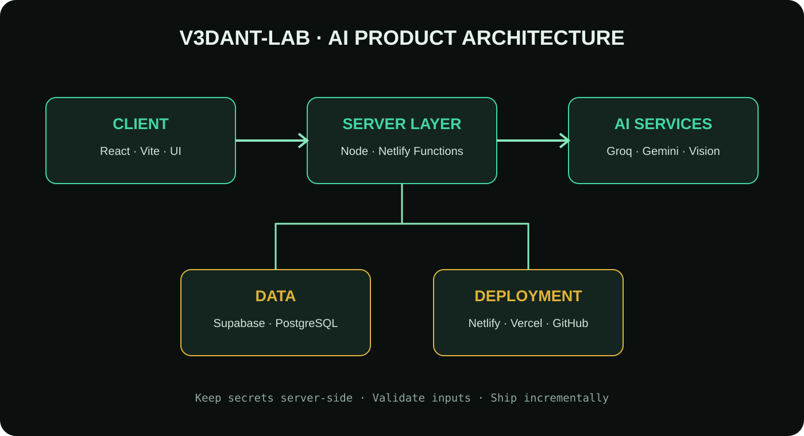

<div align="center">


<br>


<br><br>


### FULL-STACK ENGINEER · AI BUILDER · PYTHON STUDENT

**Not just writing code. Building, experimenting, and shipping.**

[GitHub](https://github.com/V3DANT-lab) · [Portfolio](https://portfolio123v.netlify.app) · [Instagram](https://instagram.com/v.edant_20) · [Email](mailto:wazevedant5@gmail.com)

</div>

---

```bash
vedant@devos ~ % ./profile.sh --live

[IDENTITY]       vedant_waze
[ROLE]           Full-Stack Engineer / AI Builder
[LOCATION]       Maharashtra, India
[STATUS]         BUILDING | LEARNING | SHIPPING
[CURRENT_BUILD]  DripIQ — AI Fashion Assistant
[RECENT_SHIPS]   SnapFaceX | Aria | Musix
[STACK]          React · Node · Supabase · Groq
```

## `$ whoami`

I'm a self-directed **Full-Stack Developer and AI Builder** interested in creating practical, AI-integrated products.

I enjoy taking ideas from concept to implementation: designing interfaces, integrating APIs, working with databases, building backend systems, and deploying applications.

- **Product engineering:** Building complete applications, not just isolated demos.
- **Applied AI:** LLMs, generative AI and computer vision.
- **Full-stack development:** Frontend, backend, databases and APIs.
- **Security:** Server-side API handling and authentication fundamentals.
- **Continuous learning:** Strengthening Python, programming fundamentals and engineering skills.

> My goal: become an engineer who understands what they're building, not just someone who can make code run.

---

## `$ ./projects.sh --featured`

<table>
<tr>
<td width="50%" valign="top">



### 👗 DripIQ — AI Fashion Assistant

Generates outfit visualizations and style recommendations.

- Outfit generation across clothing slots
- Groq-powered recommendations
- Outfit saving and regeneration

`Vite` `Supabase` `Groq` `Pollinations.AI`

**Status:** Actively developing

</td>
<td width="50%" valign="top">



### 🧠 SnapFaceX — AI Face Analysis

Combines facial landmark detection with AI-generated textual feedback.

- MediaPipe FaceMesh
- Facial landmark analysis
- AI-generated reports
- GitHub OAuth integration

`MediaPipe` `Groq` `Netlify Functions`

[Live demo](https://snapface2026.netlify.app)

</td>
</tr>
<tr>
<td width="50%" valign="top">



### 💜 Aria — Experimental AI Companion

An experimental AI companion combining voice, visual reactions and conversational intelligence.

- Procedural particle portrait
- Voice conversations
- Speech recognition and TTS
- Animated expressions and persistent memory

`MediaPipe` `Gemini` `Speech Recognition`

</td>
<td width="50%" valign="top">



### 🎧 Musix — Mood-Based Music Discovery

A music discovery experience built around how people feel.

- Mood selection
- Recommendation cards
- AI-assisted discovery
- Responsive interface

`HTML` `CSS` `JavaScript`

[Live demo](https://musix2026.netlify.app)

</td>
</tr>
</table>

---

## `$ cat /etc/tech-stack`

**Languages**

<p>

</p>

**Frontend and UI**

<p>

</p>

**Backend and data**

<p>

</p>

**Tools and infrastructure**

<p>

</p>

---

## `$ ./architecture.sh`

<p align="center">

</p>

### Engineering principles

| Principle | In practice |
|---|---|
| 🔐 Security first | Keep private API keys on the server |
| 🧩 End to end | Connect UI, API, database and deployment |
| 🚢 Ship and refine | Deploy, test and iterate |
| 🧠 Applied AI | Use AI to solve practical problems |
| 📚 Learn continuously | Improve fundamentals through projects |

---

## `$ ./roadmap.sh`

| Area | Current focus |
|---|---|
| Python | Strengthening fundamentals |
| AI engineering | LLMs, agents and computer vision |
| Full stack | React, Node and databases |
| Systems | C, C++ and DSA |
| Security | Secure application architecture |
| Robotics | ARBAAZ — personal AI robot project |

---

## `$ ./activity.sh`

<p align="center">

</p>

## `$ ./github-stats.sh`

<p align="center">

<br>


</p>

---

## `$ ./connect.sh`

Have an interesting idea or an AI project to build? Let's connect.

<p align="center">
<a href="https://github.com/V3DANT-lab"></a>
<a href="https://instagram.com/v.edant_20"></a>
<a href="https://portfolio123v.netlify.app"></a>
<a href="mailto:wazevedant5@gmail.com"></a>
</p>

<div align="center">

### `echo "Build in silence."`

*Let the shipped product speak.*


</div>
