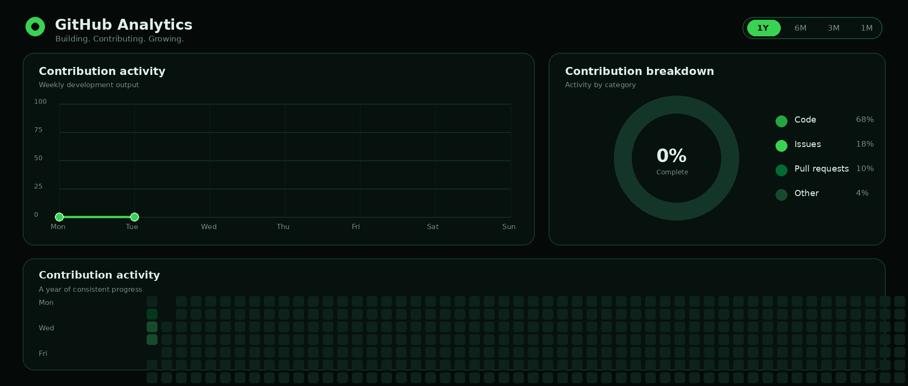
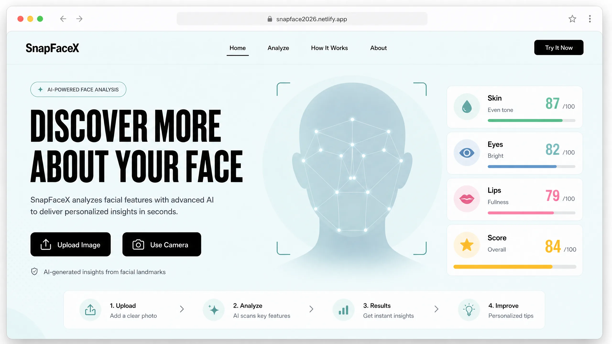
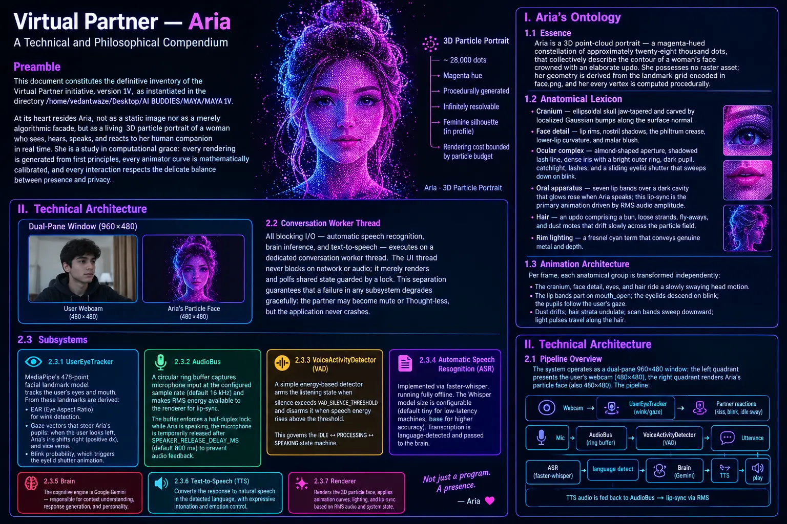

<div align="center">


<br>

<sub>✦ BUILDING · EXPERIMENTING · SHIPPING ✦</sub>

<br><br>


</div>

<br>

<div align="center">


**Not tutorials. Deployed apps with real APIs, real architecture, and real ambition.**

</div>

```bash
vedant@devos ~ % ./profile.sh --live
```

<p align="center">
  <picture>
    <source media="(prefers-color-scheme: dark)" srcset="./assets/file_0000000088dc8207ac28978e809a72ea.gif">
    <source media="(prefers-color-scheme: light)" srcset="./assets/file_0000000088dc8207ac28978e809a72ea.gif">
    
  </picture>
</p>

<br>

<p align="center">
  <picture>
    <source media="(prefers-color-scheme: dark)" srcset="./dist/v3dant-contribution-dark.svg">
    <source media="(prefers-color-scheme: light)" srcset="./dist/v3dant-contribution-light.svg">
    
  </picture>
</p>




<table>
<tr>
<td width="40%" valign="top">

<details open>
<summary><strong>🛡️ System Profile</strong></summary>
<br>

| Attribute | Details |
|---|---|
| 👤 Subject | Vedant Waze |
| 🎯 Role | Full-Stack Engineer · AI Builder |
| 📍 Origin | Maharashtra, India |
| ⚡ Status | Building · Learning · Shipping |
| 🛠️ Tools | VS Code · Git · Netlify |
| 💬 Languages | JavaScript · TypeScript · Python · C · C++ |
| 🎨 Frontend | React · Vite · Tailwind |
| ⚙️ Backend | Node.js · Netlify Functions |
| 🗄️ Database | Supabase · PostgreSQL |
| ☁️ Deployment | Netlify · Vercel |

</details>

</td>
<td width="60%" valign="top">

## 👨‍💻 About Me

I'm a self-directed **full-stack developer and AI builder** focused on creating practical, AI-integrated applications.

- 🧱 **Product mindset:** Building complete applications from idea to deployment.
- 🤖 **Applied AI:** Working with LLMs, generative AI and computer vision.
- 🔐 **Security-first:** Server-side API keys, secure authentication and protected APIs.
- 🌱 **Always learning:** Deepening my Python, C/C++ and engineering fundamentals.
- 🚀 **Building in public:** Learning by creating and shipping real projects.

</td>
</tr>
</table>

## 🎯 Right Now

| 🔨 Building | 📚 Learning | 🚀 Shipped |
|:---|:---|:---|
| **DripIQ** — AI Fashion Assistant | Python, C++, DSA, Computer Vision | **SnapFaceX** · **Aria** · **Musix** |


## 🧰 Tech Stack

<p align="center">
  
  <br>
  
  <br>
  
  <br>
  
</p>

## 🏗️ Architecture Overview

<p align="center">
  <picture>
    <source media="(prefers-color-scheme: dark)" srcset="./assets/architecture-dark.webp">
    <source media="(prefers-color-scheme: light)" srcset="./assets/architecture-light.webp">
    
  </picture>
</p>

## 🧭 How I Build

| | Principle | In Practice |
|:-:|:--|:--|
| 🔐 | **Secure by default** | API keys stay server-side, behind Netlify Functions |
| 🚢 | **Ship, then refine** | Projects go live, then get iterated on |
| 🧩 | **End to end** | UI, API, database, auth and deployment |
| 📓 | **Build in public** | Documenting the journey as I go |


## 🚀 Featured Projects

<table>
<tr>
<td width="50%" valign="middle">

</td>
<td width="50%" valign="middle">

### 👗 DripIQ
**AI Fashion Assistant**

Generates outfit visualizations across head, middle and lower slots with generative image models, plus Groq-powered style recommendations.

`Vite` `Supabase` `Groq` `Pollinations.AI` `Netlify Functions`

🔐 Server-side API keys.

🟢 **Actively in development**

</td>
</tr>

<tr>
<td width="50%" valign="middle">

### 🧠 SnapFaceX
**AI Face Analysis Tool**

Combines MediaPipe FaceMesh landmark detection with LLM-generated feedback.

`MediaPipe` `Groq` `GitHub OAuth` `Netlify Functions`

🔐 Server-side proxy and protected OAuth.

<a href="https://snapface2026.netlify.app">

</a>

</td>
<td width="50%" valign="middle">

</td>
</tr>

<tr>
<td width="50%" valign="middle">

</td>
<td width="50%" valign="middle">

### 💜 Aria
**AI Virtual Partner (V1)**

AI brought to life through particles, voice and intelligence, with a procedurally generated 3D portrait of about 28,000 magenta particles.

`MediaPipe` `Gemini` `Speech Recognition` `TTS` `Lip-sync`

✨ Real-time visual reactions, voice conversations and persistent memory.

</td>
</tr>

<tr>
<td width="50%" valign="middle">

### 🎧 Musix
**AI Mood-Based Music Discovery**

Find songs that match how you feel, without endless scrolling.

`Mood Selection` `Recommendation Cards` `AI-assisted Discovery`

<a href="https://musix2026.netlify.app">

</a>

</td>
<td width="50%" valign="middle">

</td>
</tr>
</table>


## 📊 GitHub Stats

<p align="center">
  
  <br>
  
  
</p>


## 🤝 Let's Build Something

Have an idea, a collaboration, or an AI project that needs shipping? I'd love to hear about it.

<p align="center">
  <a href="https://github.com/V3DANT-lab"></a>
  <a href="https://instagram.com/v.edant_20"></a>
  <a href="https://portfolio123v.netlify.app"></a>
  <a href="mailto:wazevedant5@gmail.com"></a>
</p>

<div align="center">

*Build in silence, let the shipped product speak.*


</div>
