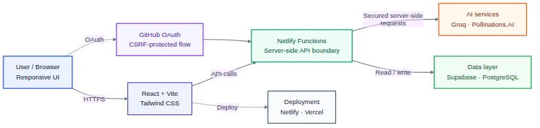
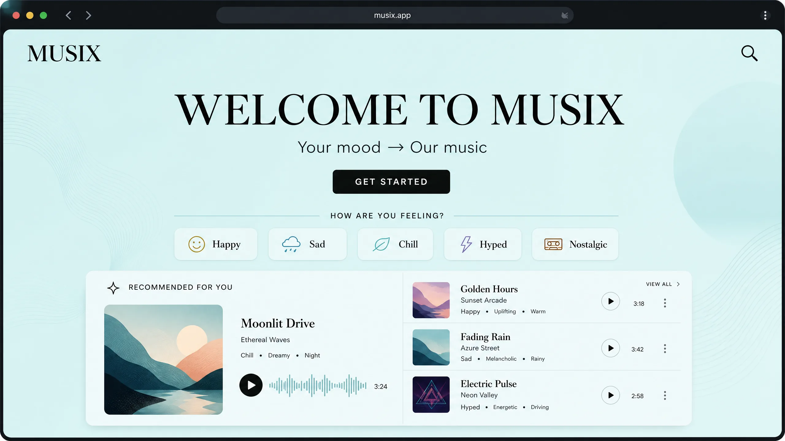

<div align="center">


<br>


<br>


<br>


<br><br>

<a href="https://github.com/V3DANT-lab"></a>&nbsp;&nbsp;&nbsp;&nbsp;
<a href="https://instagram.com/v.edant_20"></a>&nbsp;&nbsp;&nbsp;&nbsp;
<a href="mailto:wazevedant5@gmail.com"></a>&nbsp;&nbsp;&nbsp;&nbsp;
<a href="https://portfolio123v.netlify.app"></a>
<br><br>


<br>


<br><br>


</div>

<br>

<div align="center">


**Not tutorials. Deployed apps with real users, real APIs, and real security.**

</div>

```
vedant@devos ~ % ./profile.sh --live
```

<picture>

<source media="(prefers-color-scheme: dark)" srcset="./assets/file_0000000088dc8207ac28978e809a72ea.gif">
<source media="(prefers-color-scheme: light)" srcset="./assets/file_0000000088dc8207ac28978e809a72ea.gif">

</picture>

<br>

<p align="center">
  <picture>
    <source media="(prefers-color-scheme: dark)" srcset="./dist/v3dant-contribution-dark.svg">
    <source media="(prefers-color-scheme: light)" srcset="./dist/v3dant-contribution-light.svg">
    
  </picture>
</p>


<table>
  <tr>
    <td width="40%" valign="top">
      <details open>
      <summary><strong>🛡️ System profile</strong></summary>
      <br>
      <table>
        <tr><td>👤 <b>Subject</b></td><td>Vedant Waze</td></tr>
        <tr><td>🎯 <b>Role</b></td><td>Full-Stack Engineer · AI Builder</td></tr>
        <tr><td>📍 <b>Origin</b></td><td>Maharashtra, India</td></tr>
        <tr><td>⚡ <b>Status</b></td><td>Building · Learning · Shipping</td></tr>
        <tr><td>🛠️ <b>Toolchain</b></td><td>VS Code · Git · Netlify · Supabase</td></tr>
        <tr><td>💬 <b>Languages</b></td><td>JavaScript · TypeScript · Python · HTML · CSS</td></tr>
        <tr><td>🎨 <b>Frontend</b></td><td>React · Vite · Tailwind CSS</td></tr>
        <tr><td>⚙️ <b>Backend</b></td><td>Node.js · Netlify Functions</td></tr>
        <tr><td>🗄️ <b>Data</b></td><td>Supabase · PostgreSQL</td></tr>
        <tr><td>☁️ <b>Infra</b></td><td>Netlify · Vercel · Git</td></tr>
      </table>
      </details>
    </td>
    <td width="60%" valign="top">
      <h2>👨‍💻 About Me</h2>
      I'm a self-directed <b>full-stack developer and AI builder</b> shipping production-grade web applications. My focus is secure, AI-integrated systems, from the first commit to the live deploy.
      <br><br>
      <ul>
        <li>🧱 <b>Product mindset:</b> I design, build, and ship the whole thing end to end</li>
        <li>🤖 <b>Applied AI:</b> practical LLM and generative AI integration with Groq, Gemini, and Pollinations.AI</li>
        <li>🔐 <b>Security-first:</b> server-side-only API keys, CSRF-protected OAuth, and I've personally remediated exposed keys</li>
        <li>🌱 <b>Always leveling up:</b> deepening my Python while building in public</li>
      </ul>
    </td>
  </tr>
</table>

## 🎯 Right Now

| 🔨 Building | 📚 Learning | 🚀 Shipped |
|:---|:---|:---|
| **DripIQ**, an AI fashion assistant | Python, going deeper | **SnapFaceX** · **Aria** · **Musix** |


<!-- Update v=20261028 whenever you change the icon list. -->
## 🧰 Tech Stack

<p align="center">
  
  <br>
  
  <br>
  
  <br>
  
</p>

## 🏗️ Architecture Overview

<p align="center">
<picture>
    <source media="(prefers-color-scheme: dark)" srcset="./assets/architecture-dark.webp">
    <source media="(prefers-color-scheme: light)" srcset="./assets/architecture-light.webp">
    
  </picture>
</p>

## 🧭 How I Build

| | Principle | In practice |
|:-:|:--|:--|
| 🔐 | **Secure by default** | API keys stay server-side, behind Netlify Functions |
| 🚢 | **Ship, then refine** | Every project goes live, then gets iterated on |
| 🧩 | **End to end** | UI, API, database, auth, and deploy, all owned |
| 📓 | **Build in public** | Documenting the journey as I go |


## 🚀 Featured Projects

<table>
  <tr>
    <td width="50%" valign="middle">
      
    </td>
    <td width="50%" valign="middle">
      <h3>👗 DripIQ</h3>
      <b>AI Fashion Assistant</b><br>
      Generates outfit visualizations across head, mid, and lower slots with generative image models, plus Groq-powered style recommendations.<br><br>
      <code>Vite</code> <code>Supabase</code> <code>Groq</code> <code>Pollinations.AI</code> <code>Netlify Functions</code><br><br>
      🔐 Server-side-only API keys, zero client-exposed secrets<br>
      🟢 <b>Actively in development</b>
    </td>
  </tr>
  <tr>
    <td width="50%" valign="middle">
      <h3>🧠 SnapFaceX</h3>
      <b>AI Face Analysis Tool</b><br>
      Live platform combining MediaPipe FaceMesh landmark detection with LLM-generated feedback.<br><br>
      <code>MediaPipe FaceMesh</code> <code>Groq · Llama-3.3-70B</code> <code>GitHub OAuth</code> <code>Netlify Functions</code><br><br>
      🔐 Server-side proxy for key protection and CSRF-protected OAuth<br>
      <a href="https://snapface2026.netlify.app"></a>
    </td>
    <td width="50%" valign="middle">
      
    </td>
  </tr>
  <tr>
    <td width="50%" valign="middle">
      
    </td>
    <td width="50%" valign="middle">
      <h3>💜 Aria</h3>
      <b>AI Virtual Partner (V1)</b><br>
      AI brought to life through particles, voice, and intelligence, with a procedurally generated 3D portrait of about 28,000 magenta particles.<br><br>
      <code>MediaPipe</code> <code>Google Gemini</code> <code>Speech Recognition</code> <code>TTS + Lip-sync</code><br><br>
      ✨ Real-time visual reactions, voice conversations, animated expressions, persistent memory, multilingual, with graceful offline fallbacks
    </td>
  </tr>
  <tr>
    <td width="50%" valign="middle">
      <h3>🎧 Musix</h3>
      <b>AI Mood-Based Music Discovery</b><br>
      Find songs that match how you feel, without endless scrolling.<br><br>
      <code>Mood selection</code> <code>Recommendation cards</code> <code>AI-assisted discovery</code> <code>Responsive</code><br><br>
      <a href="https://musix2026.netlify.app"></a>
    </td>
    <td width="50%" valign="middle">
      
    </td>
  </tr>
</table>


## 📊 GitHub Stats

<p align="center">
  
  <br>
  
  
</p>


## 🤝 Let's Build Something

Have an idea, a collaboration, or an AI project that needs shipping? I'd love to hear about it.

<p align="center">
  <a href="https://github.com/V3DANT-lab"></a>
  <a href="https://instagram.com/v.edant_20"></a>
  <a href="https://portfolio123v.netlify.app"></a>
  <a href="mailto:wazevedant5@gmail.com"></a>
</p>

<div align="center">

*Build in silence, let the shipped product speak.*


</div>
